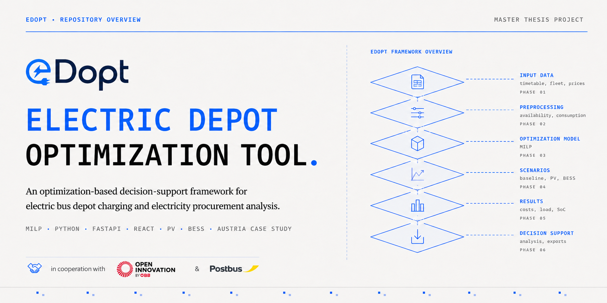

<div align="center">
  
</div>

<br>

<div align="center">

# eDOPT

**Electric Depot Optimization & Planning Tool**

A web-based research prototype for analyzing electricity procurement and charging schedules in battery-electric bus depots.

[](LICENSE)
[](https://www.python.org/)
[](https://fastapi.tiangolo.com/)
[](https://reactjs.org/)
[](https://vitejs.dev/)
[](https://www.smard.de/)
[](https://www.awattar.at/)
[](https://open-meteo.com/)
[](https://coin-or.github.io/pulp/)

[Research Context](#research-context) • [Purpose and Scope](#purpose-and-scope) • [Main Functions](#main-functions) • [Architecture](#architecture) • [Quick Start](#quick-start) • [License](#license)

</div>

---

## Research Context

eDOPT was originally developed by **Martin Pfeiffer, MSc. BSc.** as the software artifact of the master's thesis:

> *Electricity Procurement Cost Minimization for Depot Charging of Electric Buses: An Optimization-Based Decision-Support Framework*

The thesis was conducted at the **Vienna University of Economics and Business (WU Vienna)**, within the **Institute for Data, Energy, and Sustainability (IDEaS)** at the Department of Information Systems and Operations Management.

Academic supervision was provided by **Behnam Zakeri, DSc.**, with **Dr. Amin Anjomshoaa** as co-supervisor. The project was developed in cooperation with the **ÖBB Open Innovation** and **Postbus GmbH**. The industry partners contributed to the underlying problem definition, provided operational context and case-study data, and supported the applied development of the framework.

The repository contains the original thesis-based decision-support tool and its subsequent development. Confidential operational data used in the Wels case study are not included.

### Development after the thesis

**The current repository has evolved beyond the version used in the master's thesis. All updates described in the recent development work were introduced after completion of the thesis.** These include the expanded charging-location and switching rules, optional charging trips, refined route diagnostics, historical price caching and averaging, flat-rate analysis and comparisons, parallel Daily Cyclic analysis with PV/BESS and cached historical weather, and the revised results, progress and export interfaces.

The feature descriptions and usage instructions below document the current application. They must not be interpreted as a list of features implemented or evaluated in the thesis. The thesis findings refer to the implementation, assumptions and case-study runs used at that time; subsequent enhancements are further developments and are not retroactively part of its empirical evaluation.

---

## Purpose and Scope

Electric bus depots must supply the energy required by their fleets within charging windows defined by fixed vehicle circulation plans. At the same time, charging is constrained by vehicle availability, battery limits, charger capacity, and the depot grid connection. When electricity prices vary over time, the allocation of charging demand across feasible periods can influence procurement costs.

eDOPT represents this problem as a mixed-integer linear programming model. The model determines charging schedules within the available depot windows while respecting bus-level and depot-level constraints. Optional scenario extensions include photovoltaic generation and a stationary battery energy storage system.

The tool is intended for:

- scenario analysis and research
- evaluation of charging schedules under time-varying electricity prices
- comparison of charge-on-arrival and optimized charging strategies
- analysis of PV and BESS integration under defined assumptions
- preparation of operational cost estimates for further planning or investment analysis

The tool is **not** a real-time charging controller. It does not communicate with physical chargers, modify vehicle timetables, or provide a complete investment appraisal. Results depend on the uploaded operational data and the selected technical, economic, and infrastructure assumptions.

---

## Main Functions

| Function | Description |
| :--- | :--- |
| **MILP optimization** | Uses PuLP and CBC to allocate charging power across buses and time periods under the configured constraints. |
| **Vehicle circulation processing** | Converts compatible vehicle circulation plans into bus-specific availability windows and trip-energy profiles. |
| **Electricity price inputs** | SMARD AT with persistent cache by default, explicit aWATTar selection, 15/30/60-minute averaging, configurable fees/taxes and flat-rate runs. |
| **Bus-level constraints** | Represents battery capacity, state of charge, charging efficiency, maximum charging power, scheduled energy consumption, and readiness requirements. |
| **Charging locations** | Per-site connector counts, charger ratings, aggregate charging limits, grid limits and switching windows; buses can arrive and connect to a free socket during a switching lock. |
| **PV and BESS scenarios** | Baseline, PV, BESS and PV+BESS scenarios, including independent Daily Cyclic analysis with cached historical weather and hard daily BESS energy equality. |
| **Long-term analysis** | Flexible chunk simulation or independent Daily Cyclic jobs, bounded parallelism, cancellation, configurable solver time limits and retained partial results. |
| **Result visualization** | Charging, SoC, costs and source flows; daily energy mix in absolute kWh, synchronized zoom and source visibility controls. Diagnostic cards are grouped in a collapsed Analysis details & checks panel. |
| **Scenario comparison** | Compares reference and optimized configurations using common operational input data. |
| **Data export** | Background ZIP/CSV exports with progress and cancellation; complete analysis evidence and long-term Route Summary CSV. PDF reporting is currently disabled. |

---

## Simulation Modes and Current Limits

| Mode | Behavior |
| :--- | :--- |
| **Short-Term** | One configured horizon with the selected scenario and operating constraints. Daily Start SoC = End SoC applies to complete cyclic 24-hour runs. |
| **Long-Term / Flexible** | Sequential chunks carrying bus energy and connection states into the next chunk. This is distinct from independent daily cycling. |
| **Long-Term / Daily Cyclic** | One complete 24-hour solve per supported historical date, with the same daily timetable. Supports baseline, PV, BESS and PV+BESS; both date endpoints are included. |

Daily Cyclic verifies a reference day before starting up to four concurrent day jobs. The effective
worker count is limited by the selected count, backend CPU/available RAM, `EDOPT_DAILY_WORKERS`
and the proof of repeatable necessary midnight connector states. It can fall back to serial execution
for model continuity even when RAM is available; the reference-day error and measured capacity are
shown separately. Inactive saved PV/BESS settings do not affect this proof. Solver time limits are
configured under **Advanced Solver Settings**; changing worker count does not shorten a solve.
Running optimizations can be cancelled.

Each Daily Cyclic day enforces bus Start SoC = End SoC. When BESS is active, its final energy also
equals its configured initial energy every day; no stationary-storage energy is carried between
independent dates. Temperature-dependent BESS derating is currently blocked in this mode.
Compare All, overnight optional charging visits and calendar-specific weekday/holiday timetable
changes are not supported in Daily Cyclic. Independent daily solutions are not a global annual optimum.

Europe/Vienna daylight-saving transition days (23/25 hours) are skipped and marked. Other failed
dates retain their individual reasons while the remaining dates continue. Completed partial results
open in Results; excluded dates contribute to no cost, energy, peak or comparison totals, and missing
results are never replaced by zeros or extrapolated to a full year. An optional post-run retry targets
remaining historical-input gaps; it does not silently relax infeasible solver constraints.

### Prices and flat-rate comparisons

The selected market source applies across simulation modes. SMARD AT is the default; aWATTar is
an explicit alternative. Energy-Charts can be enabled for remaining historical gaps in the SMARD
access path. Original source intervals and provenance are retained. A selectable 15/30/60-minute
window forms duration-weighted spot-price averages; it does not change the solver time step or
cached original prices. Incomplete coverage remains visible, with no repeated-day replacement.
Future day-ahead prices may not yet be published.

**Use flat rate for the main analysis** applies the entered EUR/kWh price to every time slot,
with existing fees and taxes added. It requires no market-price download; all operating constraints
remain active, and charging times may be non-unique. Alternatively, a market-price run can add a
separate flat-rate valuation of the existing charge-on-arrival schedule. This retains the original
arrival comparison; the extra comparison is disabled for a flat-rate main run. An arrival reference
that violates operating conditions is explicitly non-comparable.

### Historical weather and PV/BESS

Daily PV uses a persistent Open-Meteo Archive cache. Select **ERA5** (default, approximately five
days archive delay) or **ECMWF IFS** (archive from 2017 with more recent coverage), then use
**Check weather coverage** or **Load missing weather**. Runs also prepare missing data automatically.
The UI distinguishes cached dates, loading, incomplete dates, archive cutoffs and provider errors.
A current/recent day can still lack hourly observations. Models have separate cache identities;
there is no automatic model mixing or fabricated replacement irradiance.

The Daily Cyclic PV model is an explicit horizontal-irradiance approximation:
`PV kW = installed kWp × irradiance W/m² / 1000 × performance ratio` (default ratio 0.85).
It does not model orientation, shading or cell temperature, and does not normalize output to the
selected period's peak. Raw irradiance/temperature can be reused after changing PV capacity;
each request records source/model, timestamps, units and snapshot evidence. Existing Short-Term
and Flexible PV generation paths are unchanged. See [Daily Cyclic energy details](docs/daily-cyclic-energy.md).

### Cache persistence and exports

| Setting | Default / purpose |
| :--- | :--- |
| `EDOPT_PRICE_CACHE_PATH` | `backend/data/historical_prices.sqlite3`; persistent historical price observations. |
| `EDOPT_WEATHER_CACHE_PATH` | `backend/data/historical_weather.sqlite3`; persistent raw weather per location/model. |
| `EDOPT_DAILY_WORKERS` | Backend worker ceiling, capped at four and reduced by measured resource capacity. |

For deployments, set cache paths to files on a persistent mounted volume. Local caches are reused
after restart; deployment persistence cannot be inferred automatically. Shared preparation may finish
in the background when a user cancels waiting.

The **Complete Analysis Package** ZIP includes saved results, settings, exact archived requests,
input evidence and detailed CSV tables. Daily runs also include historical weather evidence and
BESS start/end checks. Exports run in a browser worker to keep the page responsive.

**Route Summary CSV**, available on Results and Export for long-term analyses, is Excel-compatible
and includes route ID, vehicle group, scheduled diesel-equivalent distance, electric distance including
chosen charging detours, electrical feasibility, grid energy, semicolon-separated charging sites and
an energy-source explanation. PV/BESS assignments are documented allocations, not per-bus metering.
Only evaluated days contribute; year-labelled columns do not imply extrapolation of missing dates.
The Results PDF button is currently disabled.

---

## Architecture

The application follows a modular client-server architecture:

```text
┌───────────────────────────────────────────────────────────────────┐
│                    React + Vite Web Interface                     │
│        Input configuration, scenario setup, charts, tables        │
└─────────────────────────────────┬─────────────────────────────────┘
                                  │ REST API (JSON)
┌─────────────────────────────────▼─────────────────────────────────┐
│                         FastAPI Backend                           │
│       Request handling, preprocessing, external data services     │
└─────────────────────────────────┬─────────────────────────────────┘
                                  │ Model data and constraints
┌─────────────────────────────────▼─────────────────────────────────┐
│                       MILP Model with PuLP                        │
│            Charging, grid, PV, BESS, and SoC constraints          │
└─────────────────────────────────┬─────────────────────────────────┘
                                  │ CBC solver
┌─────────────────────────────────▼─────────────────────────────────┐
│                    Structured Results and Exports                 │
│       Costs, charging schedules, SoC profiles, energy flows       │
└───────────────────────────────────────────────────────────────────┘
```

The frontend is responsible for user interaction and result presentation. The backend prepares uploaded data, retrieves external inputs where required, constructs the selected optimization scenario, executes the solver, and returns structured results.

---

## Quick Start

### Prerequisites

- **Node.js** 20.19+ (20.x) or 22.12+ and **npm** (Vite 8 requirement)
- **Python** 3.10 or higher
- Windows for the provided `.cmd` setup and start scripts

### 1. Installation

Clone the repository and run the provided dependency installer:

```bash
git clone https://github.com/Gather9182/eDOPT.git
cd eDOPT
install_dependencies.cmd
```

The script creates the backend virtual environment and installs the frontend and backend dependencies.

Manual installation is also possible:

```bash
# Frontend
cd frontend
npm install
cd ..

# Backend
cd backend
python -m venv .venv
.venv\Scripts\activate
pip install -r requirements.txt
```

### 2. Running the Application

Start the frontend and backend using:

```bash
start_all.cmd
```

The default local services are:

- **Frontend:** [http://localhost:5173](http://localhost:5173)
- **Backend:** [http://localhost:8000](http://localhost:8000)
- **API documentation:** [http://localhost:8000/docs](http://localhost:8000/docs)

---

## Repository Structure

```text
eDOPT/
├── backend/
│   ├── app/
│   │   ├── main.py                  # FastAPI entry point and API endpoints
│   │   ├── models.py                # Request and response data models
│   │   ├── services/
│   │   │   ├── solver.py            # MILP model and optimization logic
│   │   │   ├── price_service.py     # Electricity price retrieval and processing
│   │   │   ├── historical_prices.py # Strict historical price preparation
│   │   │   ├── historical_weather.py # Cached ERA5/IFS and Daily PV profiles
│   │   │   └── pv_service.py        # Legacy Short-Term/Flexible PV profiles
│   │   └── utils/
│   │       ├── excel_processor.py   # Vehicle circulation plan processing
│   │       └── excel_exporter.py    # Result export generation
│   └── requirements.txt             # Python dependencies
├── frontend/
│   ├── src/
│   │   ├── pages/                   # Main application views
│   │   ├── components/              # Interface components and charts
│   │   ├── services/                # Backend API client
│   │   └── App.jsx                  # Application state and routing
│   ├── package.json                 # Frontend dependencies and scripts
│   └── vite.config.js               # Vite configuration
├── assets/
│   └── edopt-repository-banner.png  # README and repository banner
├── install_dependencies.cmd         # Dependency installation script
├── start_all.cmd                    # Frontend and backend launcher
├── start_backend.cmd                # Backend launcher
├── start_frontend.cmd               # Frontend launcher
├── LICENSE                          # License terms
└── README.md                        # Repository documentation
```

---

## Workflow

1. **Upload operational data:** Provide a compatible vehicle circulation plan or use the included non-confidential example input.
2. **Configure and continue:** Configure import options, vehicle types and charging locations, then click **Continue to Settings**. The current timetable is processed and applied automatically before navigation; generating a preprocessing preview is optional.
3. **Configure the depot:** Define vehicle assumptions, charger capacity, charging sockets, grid connection limits, and state-of-charge requirements.
4. **Configure prices:** Select time-varying or fixed electricity prices and define additional variable procurement components.
5. **Select a scenario:** Run the optimized baseline, PV, BESS, or combined PV-BESS model.
6. **Execute the optimization:** Solve the configured model and review solver and feasibility information.
7. **Analyze the results:** Inspect charging schedules, state-of-charge profiles, costs, grid imports, PV utilization, and BESS operation.
8. **Compare and export:** Compare scenarios and export relevant result data.

---

## Data Availability and Reproducibility

### Importing other timetables and configuring charging locations

The import screen supports worksheet selection and operating-day labels. For a sheet named
`Mo-Do Schule`, all operating-day labels are selected by default. The import summary states
how many source rows were retained or excluded. Times such as `00:19[+1]` retain their day
offset; malformed times produce an error instead of silently removing a trip.

**Continue to Settings** processes the current Excel source with all current import, vehicle
and location settings, applies the returned bus profiles and then opens optimization settings.
There is no separate timetable-apply step. Errors keep the input screen open with an explanatory
message. The Excel source is retained locally in browser storage so that editing locations or
vehicle specifications later also regenerates the profiles, including after a page reload.
Projects imported before source-file caching may need the original Excel file uploaded once.
Vehicle specifications can be configured immediately after upload without generating a preview.
Price assumptions are stored as edited; fetching prices applies them automatically, and a newly
selected market date is synchronized on Continue if it has not yet been applied.

After **Run Check**, route diagnostics distinguish an energetically feasible timetable from one
that also satisfies Start SoC = End SoC. `BUS_ENERGY_INFEASIBLE` is a proof only under the
current model assumptions, with a concrete reason such as an unreachable trip minimum or final
energy target. Small deficits use numerical tolerances without hiding genuine shortfalls.
`NO_CHARGING_AVAILABILITY` is a warning that may indicate a missing site assignment; it is not
by itself proof that a route is undrivable. The optimistic per-route check does not prove joint
fleet feasibility under shared connectors and switching rules.

Routes can be excluded explicitly where offered. Results retain exclusion causes: energetic proof,
missing charging availability or manual exclusion. Unrelated errors still block optimization, and at
least one route must remain. Imported routes and their settings are retained; reprocessing the
timetable clears exclusions so corrected routes are reconsidered.

Select the distance convention explicitly. **Previous detection** retains the original Wels
interpretation. **Metres** and **kilometres** interpret all unlabelled values in the chosen unit.
**Mixed export** interprets fractional values as kilometres and integer values below a configurable
threshold as kilometres; integers at or above the threshold are metres. With threshold 50,
`21` means 21 km, `94` means 94 m, and `86.16` means 86.16 km. Explicit `m`/`km` suffixes take
precedence in the explicit modes. Check this convention against the source export. Optional
vehicle-type overrides apply a single configured vehicle type to every trip of an Umlauf.
The optional first-type checkbox uses only the part before the first slash in each source
vehicle-type label: `NGB/RB12` becomes `NGB`. Consumption and battery specifications
are looked up using the resulting type. Explicit per-Umlauf selections take precedence
over this checkbox and retain their selected label.

### Optional charging trips during timetable breaks

An optional workbook sheet **Mapping Lademöglichkeiten** is read automatically during
upload. Its required columns are `Haltestelle`, `Ladestandort`, `Hinweg`, and `Rückweg`.
Travel times are minutes (for example `15 min`). Optional `Hinweg (km)` and `Rückweg (km)`
columns supply distances; otherwise enter them in **Ladeorte & Sperrzeiten → Zusätzliche
Lademöglichkeiten mit Hin- und Rückfahrt**. Missing distances remain missing and the affected
connections are skipped with an explanation. A zero-minute link defaults to zero kilometres.
The source workbook is not edited.

Enable optional trips and link each destination to an existing physical charging site.
Zero-minute mappings to depot A/E nodes can suggest that site automatically; shared
destinations share the same connector, power and grid limits. Stop nodes, site assignment,
outbound/return times and distances are editable. Global minimum charging time, buffer per
direction, minimum net battery-energy gain and minimum power during counted charging slots
are configurable. Minimum time and buffer can also be overridden per connection. Optional
allowed transfer windows restrict driving; an empty list permits driving throughout the day.
New workbooks start with this feature disabled.

Continue to Settings regenerates optional visits from actual gaps between fixed movements.
The solver chooses whether to visit and when to depart and return, allows at most one
destination per pause, and includes both travel legs in the battery equations only when
selected. Original route movements and their energy remain unchanged. Both driving legs and
the configured minimum charging duration must fit in the pause. Durations are rounded up and
pause boundaries inward to the chosen time grid. Minimum charging time counts only slots at
or above the configured minimum power; the configured net gain is after travel consumption
and charging losses. A bus must already have enough energy to reach the charger.

While travelling it cannot charge or occupy its original connector. Site switching locks and
arrival permissions also apply to optional visits; optional departures cannot bypass a lock.
Results and Excel/JSON exports show chosen departures, charger arrival, return, extra distance
and travel energy. Single-run audit inputs include realized transfer energy and trips while
retaining original inputs for the charge-on-arrival comparison, which does not use optional
trips. In non-cyclic long-term chunks, optional trips must finish inside the chunk: cross-chunk
visits are omitted rather than creating unfinished travel or losing energy. Choose a longer
continuous chunk to consider a break spanning midnight. Cyclic single-day runs support
overnight visits across the repeating-day boundary.

Under **Ladeorte & Sperrzeiten**, enable separate charging locations. Import the suggested A/E
node pairs or add locations manually, then assign all timetable nodes representing each physical
site. These are candidate sites, not evidence of installed charging infrastructure.
Use **Ausgewählte A/E-Knoten übernehmen** to transfer only the A/E nodes selected in the
Umlaufplan pill selector. Existing locations retain their capacities and switching windows;
missing nodes are added to the matching location without creating duplicate assignments.
Enter the actual
number of connectors, power per connector, aggregate charging power and grid limit at each site.
With separate locations enabled, each site uses its own grid, aggregate-power and connector
limits. Legacy global limits apply to the single-site mode, not as an additional multi-site cap. Continue automatically regenerates
the timetable after changes to node mappings. Intermediate stops can also be used without A/E trip markers.

Charging is allowed only in full time slots contained in a stay, with no driving overlap. Physical
presence includes partial boundary slots so that a socket cannot be reassigned before departure.
Every positive-duration movement, including type B, blocks charging. Arrivals after midnight are
included in repeated operating-day profiles. This is a repeated timetable, not a calendar-aware
selection of different Monday/Tuesday timetables or public holidays.

Each location supports multiple daily **no-switch windows**, including windows crossing midnight.
Equal start/end times block switching all day. During a window, a parked connected bus keeps its
connector even at zero charging power. Depending on the configured lock charging mode, power
remains optimized or is allocated as evenly as possible across chargeable buses within the
configured power/SoC limits. Timetable departures are always permitted. A newly arriving bus can
connect to a free connector during a lock; it cannot displace another parked vehicle or manually
disconnect before the lock ends. Lock boundaries within a time slot
are treated conservatively by blocking switching for that slot. Connector identity within a site is
interchangeable: connectors at one site share the same configured power rating.

For repeated complete-day horizons, overnight connections remain consistent across the horizon
boundary. Long-term simulation carries connection states, as well as SoC, into the next chunk.
PV and the stationary BESS must be assigned to one location and cannot supply other sites.
An infeasible location-constrained MILP is reported as a failure; the legacy heuristic is not used
because it cannot represent physical connections. The charge-on-arrival comparison uses the same
site/connection rules and reports unmet operating requirements instead of presenting them as a
valid cost comparison. Results and Excel exports include site power, grid import and occupied
connectors, bus connection schedules, and site settings.

Run focused checks for the changed feature rather than the full suite by default. For Daily
PV/BESS: in `backend`, set `PYTHONPATH=.;tests` in PowerShell and run
`.venv\Scripts\python.exe -m unittest test_historical_weather test_daily_energy`; in `frontend`,
run `node --test tests/dailyEnergy.test.mjs tests/dailyParallel.test.mjs`. Build the UI with
`npm run build`. Other regression modules are in `backend/tests` and `frontend/tests`.

## Source Data

The original vehicle circulation plan used for the Wels case study is not included because it contains depot-specific operational information provided by the industry partners. The exact empirical case study therefore cannot be reproduced from this repository alone.

A non-confidential example input is provided to demonstrate the input structure and application workflow. The tool can also be applied to other compatible vehicle circulation plans. Depending on the data source, depot identifiers, operating-day filters, vehicle assumptions, and scenario parameters may need to be adjusted.

Electricity price and weather-related inputs can be retrieved from external services integrated into the application. Availability, formats, and values returned by these services may change over time.

---

## Methodological Notes

The optimization results should be interpreted as scenario-based outputs under the selected assumptions. In particular:

- the vehicle circulation plan is treated as fixed
- charging is optimized only within the derived availability windows
- the model uses deterministic input data for each optimization run
- results depend on the selected planning horizon and end-of-horizon requirements
- PV and BESS scenarios represent operational energy flows, not complete investment cases
- capital expenditure, financing, maintenance, degradation, and replacement costs are outside the model scope
- PV export and BESS electricity sales are not represented in the current formulation

The current implementation includes diagnostic functions and subsequent extensions for scenario exploration. The thesis results refer to successful runs of the MILP formulation and implementation used for the thesis. They do not constitute validation of features introduced after its completion.

---

## License

The repository is provided for non-commercial academic, research, educational, and evaluation purposes under the terms stated in the [LICENSE](LICENSE) file.

Commercial use, redistribution as part of a paid service, or incorporation into commercial software requires prior written permission from the author.

---

## Acknowledgements

The original thesis project was developed at WU Vienna under the supervision of **Behnam Zakeri, DSc.**, with **Dr. Amin Anjomshoaa** as co-supervisor.

The practical problem setting and case-study context were developed in cooperation with the **ÖBB Open Innovation** and **Postbus GmbH**. Particular thanks are due to **Jan Hilmar, PhD**, and **Felix Grossar, MA**, for their guidance, operational insights, and support with the case-study data.

<div align="center">
  <sub>Thesis-based tool and subsequent development by Martin Pfeiffer, MSc. BSc. | Original thesis: WU Vienna, in cooperation with ÖBB Open Innovation and Postbus GmbH</sub>
</div>
